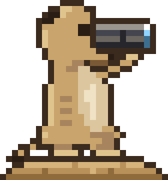

<p align="center">
  
</p>

<p align="center">
  <a href="https://github.com/khkstudios/meerkat/releases"></a>
  <a href="https://github.com/khkstudios/meerkat"></a>
  <a href="https://github.com/khkstudios/meerkat/commits/main"></a>
  <a href="LICENSE"></a>
  <br>
  <a href="https://www.python.org/"></a>
  <a href="https://opencv.org/"></a>
  <a href="https://onnx.ai/"></a>
  <a href="https://ai.google.dev/edge/mediapipe/solutions/vision/hand_landmarker"></a>
  <a href="https://numpy.org/"></a>
  <a href="https://developer.apple.com/av-foundation/"></a>
  <a href="https://pip.pypa.io/"></a>
</p>

# meerkat

Webcam face recognition for one enrolled person, with tracking, a live confidence
rectangle and distance measurement. It answers: *how far away can the camera still tell it's me?*

Python prototype (Option A in [RESEARCH.md](RESEARCH.md)): YuNet detector + SFace embeddings,
pure OpenCV, every model permissively licensed. AuraFace-v1 is a drop-in upgrade backend.

```
frame -> YuNet -> Kalman/IoU tracker -> 5-pt align -> SFace|AuraFace -> gallery max-cosine
      -> embedding-averaged fusion + hysteresis lock -> pinhole distance -> overlay + JSON events
```

## Setup

```bash
python3 -m venv .venv && source .venv/bin/activate     # Python 3.12, 3.13 or 3.14
pip install -e .                    # installs the `meerkat` command
meerkat fetch-models                # detector, recogniser, liveness, hands; SHA-256 verified
# optional: pip install -e ".[auraface]" && meerkat fetch-models --auraface
#           pip install -e ".[eval]"     (plots for `meerkat report --plot`)
```

`python -m meerkat ...` works the same as `meerkat ...`. Outside a repo checkout, models and
data live in `~/.meerkat` (override with `MEERKAT_HOME`).

**Platforms.** CI runs the tests on Ubuntu and macOS (Apple Silicon) with Python 3.12–3.14.
MediaPipe has no wheel for Intel macs, so gestures need Apple Silicon, Linux or Windows.
A few conveniences are macOS-only, and other systems fall back gracefully:

| Feature | macOS | Elsewhere |
|---|---|---|
| `--source builtin` picks the laptop camera by device type | AVFoundation (pyobjc) | camera index 0; use `--source N` |
| Countdown and throw sounds | system sounds via `afplay` | terminal bell |
| Gallery encryption key | login Keychain | OS keyring (Secret Service / Credential Locker), or `MEERKAT_GALLERY_KEY` |

On macOS, the first camera use asks for camera permission for your terminal app.

**Camera choice:** `--source` defaults to `builtin`, the laptop's FaceTime camera, picked by
device type. OpenCV's numeric indexes shift whenever an iPhone (Continuity Camera) or a
virtual camera appears, so don't rely on them. Use `--source name:<substring>` to choose
another camera, and run `python -m meerkat cameras` to list cameras with their indexes and
whether each delivers live frames.

## Use

```bash
# 1. Distance calibration: stand at a measured distance and look at the camera
meerkat calibrate --distance 1.0

# 2. Enrol: guided capture at 0.5/1/2/3/4 m, turning your head while it captures.
#    SPACE starts an 8 s countdown (with ticks) so you can walk to your spot. Capture only starts
#    once you're steady inside the band's distance range, and a chime marks each finished band.
meerkat enrol --name Keegan             # --countdown 12 for more walking time

# 3. Live
meerkat run                       # close the window to quit
meerkat run --events events.jsonl --adaptive
```

Every screen is hands-free. Calibrate, enrol and the distance sweep start their own countdowns
and move on automatically, and closing the window ends any of them. SPACE and the letter keys
still work as optional shortcuts.

The rectangle runs red → amber → green on calibrated confidence. Its thickness and fill
scale with confidence, and corner brackets mean the identity is **locked**. Labels look like
`Keegan 87% | 2.4 m | LOCKED`. When the label reads **TRACKED**, the track is still locked
but per-frame recognition has failed because the face is too small. The HUD shows two
numbers:

- **max recognised**: the furthest distance where a single frame still cleared the threshold
  on a locked track. This is the real recognition range.
- **max tracked (locked)**: how far the tracker kept your identity after recognition stopped.

**Liveness (anti-spoofing).** A printed photo or a phone or monitor showing your face can't
lock. Each track is checked by MiniFASNetV2, and a face that matches only locks once it has
averaged "real" over 5 judged frames. A spoof detected later breaks the lock (label `SPOOF?`,
event `spoof_detected`). It only judges faces at least 64 px wide (about 2.5 m at 720p) and
near-frontal, and it works on texture, so a very dark room can make real faces read as
spoofs. Use `--liveness warn` (shown, not enforced) or `--liveness off` there. 3D masks are
not covered. The model's weights were trained on CelebA-Spoof, which is licensed for
non-commercial research only.

`meerkat gallery info | delete | encrypt` inspects, securely deletes or encrypts your enrolled
data, and `meerkat forget` deletes everything (see Privacy).

## Gestures

```bash
meerkat gestures                  # hand-tracked canvas
meerkat gestures --owner-only     # only while face recognition has you LOCKED (and live)
meerkat gestures --events -       # JSON events (shape_drawn, item_moved, ...) for dassie-50m
```

Hand tracking uses MediaPipe HandLandmarker (Apache 2.0, 21 landmarks per hand, up to two hands).

| Gesture | Action |
|---|---|
| Pinch (thumb + index) in empty space and move | Draw. On release the stroke snaps to a line, circle, ellipse, rectangle or triangle; anything else stays freehand. |
| Close a **fist** over an item, move, open your hand | Grab, move and drop it |
| **Twist your wrist** while holding an item in a fist | Rotate it in the screen plane (one hand) |
| Fists on the same item with both hands | Scale and twist it |
| Drop an item on the **bin** (bottom right) | Delete it |
| **Swipe a held item quickly off-screen** and let go | Throw it away (delete). It flies off, and undo brings it back. |
| Pinch a colour swatch (top left) | Pick the drawing colour |
| Pinch the **2D/3D** button | Switch mode. In 3D, drawn shapes become solids. |
| Pinch **undo** / **save** / **hand** on the toolbar | Undo, save (PNG + JSON in `data/`), show or hide the hand skeleton |
| Pinch and hold **exit** for 1 s (or close the window) | Quit |
| Pinch-drag on a 3D solid | Tilt and turn it like a trackball. It keeps spinning briefly when you let go. |
| Both palms open, held 1.5 s | Clear the canvas |

In 3D mode: circle → sphere, ellipse → ellipsoid, square → cube, rectangle → box, triangle → pyramid,
line → cylinder. Each solid keeps the drawing's position, size and tilt. Freehand strokes stay 2D.
Solids are drawn by a small flat-shaded renderer in `meerkat/solids.py` (pure OpenCV, no 3D engine).

**Speed and reach.** The camera, hand tracking and drawing each run on their own thread, so
hands are tracked at the camera's full 30 fps (it was 15 fps when everything ran one after
another). The middle 80% of the camera view covers the whole canvas (`--reach 0.1`), so you can
reach the screen edges without your hand leaving the frame. A faint rectangle on screen shows
this reach box. MediaPipe's tracking confidence is set low (0.3), so it keeps following a hand
seen at an odd angle instead of dropping it.

A pinch only starts when the thumb and index tips stay within 0.20 × palm size for 4 frames, and
never while the hand is a fist. Pinching on a 2D item draws over it rather than grabbing it.

With one hand you can reach every axis of a solid: pinch-drag tilts and turns it, and a fist
plus wrist twist rolls it.

No keyboard is needed. Optional shortcuts: `m` 2D/3D, `u` undo, `c` clear, `s` save (PNG + JSON in `data/`), `h` toggle hand skeleton, `q` quit.

## Measuring range

```bash
meerkat sweep --label me --steps 0.5,1,1.5,2,3,4,5,6,7  # tape marks on the floor
meerkat sweep --label not_me --continuous              # other people, phone photos of you
meerkat report eval/results/*.csv --far 0.01 --plot eval/results/sweep.png
meerkat report eval/results/*.csv --far 0.01 --calibrate        # write thresholds
```

The report prints detection rate, median face px, similarity and recognition rate per step,
then the headline number: **max recognition distance at the chosen false-accept rate**.
To compare setups, repeat with `--backend auraface` and `--width 1280 --height 720`.

## Layout

| Path | Role |
|---|---|
| `meerkat/capture.py` | webcam at forced resolution (MJPG, AVFoundation on macOS), or a video file |
| `meerkat/detect.py` | YuNet wrapper, landmarks, rough yaw |
| `meerkat/align_embed.py` | `sface` / `auraface` backends, L2-normalised embeddings |
| `meerkat/gallery.py` | enrolled embeddings (tagged by band + pose), max / top-k matching, quality gates |
| `meerkat/tracker.py` | Kalman + IoU tracker, embedding-averaged fusion, hysteresis identity lock |
| `meerkat/distance.py` | pinhole estimate from box width + inter-eye distance, calibration |
| `meerkat/overlay.py` | confidence ramp, rectangles, HUD |
| `meerkat/events.py` | state-change JSON lines for dassie-50m |
| `meerkat/pipeline.py` | the per-frame loop shared by `run` and the sweep |
| `meerkat/hands.py` | MediaPipe hand tracking, pinch hysteresis, pose (open / point / fist), One Euro smoothing |
| `meerkat/shapes.py` | stroke → shape recognition, canvas items (hit-test, move, scale, rotate) |
| `meerkat/solids.py` | 3D solids from 2D shapes, trackball rotation, shaded renderer |
| `meerkat/gestures.py` | gesture canvas: interaction state machine, rendering, events |
| `meerkat/liveness.py` | MiniFASNetV2 anti-spoofing: crop, preprocessing, real/spoof logit |
| `meerkat/secure.py` | gallery encryption (Fernet, key in the OS keychain), private writes, secure delete |
| `meerkat/fetch.py` | model downloads pinned by SHA-256 (`meerkat fetch-models`) |
| `meerkat/config.py` | thresholds per backend, tracker tunables; overrides in `data/calibration.json` |
| `meerkat/evaluation/` | distance sweep logger and report / threshold calibration (`meerkat sweep`, `meerkat report`) |

Events (emitted on change only): `entered`, `recognised`, `lost_recognition_but_tracked`,
`recognition_regained`, `released`, `spoof_detected`, `approaching`, `receding`, `left_frame`.

```json
{"t": 1794673500.82, "track_id": 1, "identity": "keegan", "state": "locked", "similarity": 0.58,
 "confidence": 0.91, "distance_m": 2.4, "face_px": 61, "liveness": "real", "event": "receding"}
```

## Tests

```bash
python -m unittest discover tests     # 61 tests: tracker, lock + liveness gate, distance,
                                      # gestures, solids, encryption, forget
```

GitHub Actions runs them on every push (`.github/workflows/tests.yml`): Ubuntu and macOS with
Python 3.12, 3.13 and 3.14.

Hardware-dependent features such as the enrolment countdown and chimes need manual checks.
See [TESTING.md](TESTING.md).

## Privacy

Under POPIA, face embeddings are special personal information (RESEARCH.md §11).

- **Embeddings only.** No face images are stored, and faces of unknown people are never persisted.
- **Encrypted at rest.** Galleries are `data/gallery_<backend>.npz.enc`, encrypted with Fernet
  (AES-128 + HMAC-SHA256), written with owner-only permissions (0600). The key lives in the
  macOS login Keychain (service `meerkat`), never in the project folder. For headless use, set
  `MEERKAT_GALLERY_KEY` (generate one with `meerkat gallery newkey`). Plaintext galleries from
  older versions are encrypted on first load, and the plaintext copy is overwritten and deleted.
- **Delete my data.** `meerkat forget` lists, then securely deletes, every gallery and backup,
  the distance calibration, the evaluation logs and the keychain key (`--all` also removes saved
  gesture canvases). Secure deletion overwrites before unlinking. That's best effort on SSDs
  and APFS snapshots, which is why the data is encrypted in the first place.
- **Out of git.** `data/`, `models/` and `eval/results/` are gitignored. For a Hugging Face
  upload, list files explicitly rather than relying on `.gitignore`.
